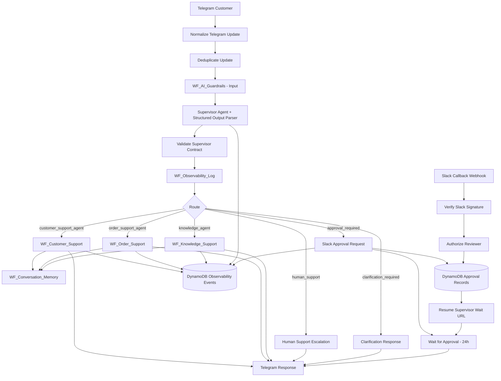

# Target architecture

## Core workflow responsibilities

- **Supervisor:** classify and route only. It does not execute business actions.
- **Customer Support:** customer profile lookup and customer-safe response.
- **Order Support:** order ID extraction and DynamoDB order lookup.
- **Knowledge Support:** Pinecone retrieval and policy-grounded response.
- **AI Guardrails:** input/output validation, simple prompt-injection and sensitive-data pattern checks.
- **Conversation Memory:** DynamoDB-backed history by Telegram session.
- **Approval Request:** persist PENDING approval and post Slack interactive card.
- **Approval Callback:** verify Slack signature, validate reviewer, conditionally update approval and resume the waiting execution.
- **Observability Log:** persist low-sensitivity structured events.
- **Error Notifier:** notify administrator when a configured workflow fails.
- **Knowledge Ingestion:** manually ingest policy PDFs from S3 into Pinecone.

## Data contracts

Each agent workflow should return at least:
- `response`
- `status`
- `agent`
- `intent`
- `correlation_id`
- `execution_id`

The Supervisor supplies:
- `message`
- Telegram identifiers
- `correlation_id`
- `execution_id`
- `request_timestamp`
- `session_id`

The exact contracts are documented in `WORKFLOW_CONTRACTS.md`.
