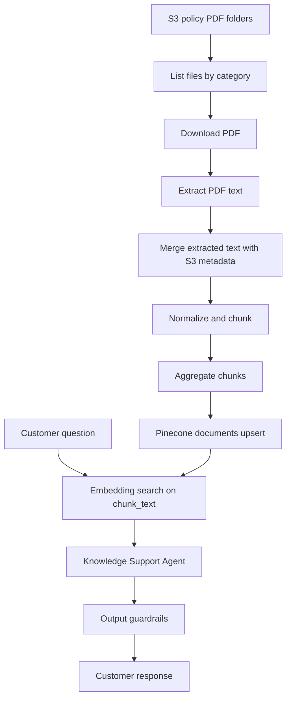

# RAG and knowledge retrieval

## Current pipeline in the supplied workflows

## Chunking currently used

- Strategy: recursive character-boundary chunking.
- Maximum target chunk size: 1,200 characters.
- Overlap: 200 characters.
- Boundary preference: paragraph, line, sentence, then word boundary.
- Metadata: document ID, title, category, source S3 key, filename, version, effective date, chunk index, total chunks, status and chunking configuration.

These are starting values, not universal settings. They must be tuned using actual policy documents and retrieval evaluation.

## Retrieval

The Knowledge Support workflow requests:
- `top_k: 4`
- embedding-based scoring using the `chunk_text` field
- metadata including title, category, version, effective date, source, document type, document ID and chunk index.

The response normalizer handles common `matches`, `result.hits`, `hits`, `result.matches` and `data.matches` response forms. Confirm the actual response shape in a live Pinecone execution.

## What is not currently implemented

- No semantic chunking.
- No reranker.
- No calibrated similarity threshold.
- No parent-child retrieval.
- No automated stale-document deactivation/version replacement.
- No labelled retrieval evaluation dataset yet.
- No independent citation rendering in the customer response.

## Required Pinecone configuration check

The index and namespace in the existing JSON must be valid. The index must support the documents API and an integrated embedding configuration that is compatible with the `chunk_text` field used for upsert and query. The exported workflow JSON does not prove the Pinecone index's model configuration.

## RAG acceptance tests

1. Ingest one known PDF from each configured category.
2. Confirm extracted text is non-empty.
3. Confirm chunks are between 1 and 1,200 characters.
4. Confirm adjacent chunks overlap as intended.
5. Confirm each chunk has document and source metadata.
6. Confirm Pinecone upsert succeeds.
7. Search a question whose answer is explicitly in one document.
8. Confirm the retrieved chunk contains the answer.
9. Search a question not covered by any document.
10. Confirm the agent refuses to invent a policy.
11. Test a stale/older policy and a newer policy with the same topic.
12. Record retrieval hit rate, answer faithfulness and no-answer correctness.

Do not call the RAG pipeline production-validated until these live tests pass.
